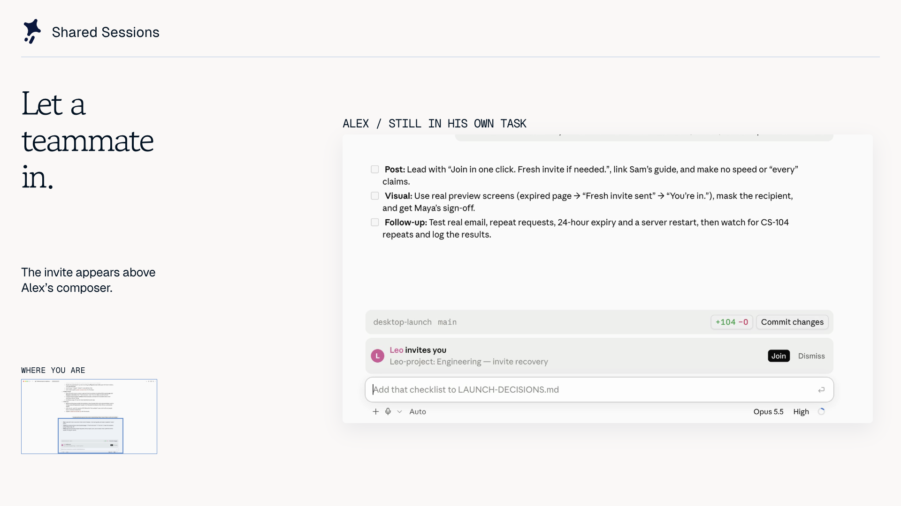

# Shared Sessions for Claude Code

Work in the same Claude session with your team. Share a link, let a teammate join from their own Claude Code, and see each other's prompts, streamed replies and tool results. The host's machine does the work.

[Install](#install) · [Try a first session](#use-it) · [Full guide](docs/guide.md) · [Contribute](CONTRIBUTING.md)

[](https://x.com/thescottfan/status/2109815791441072416)

[Watch the 90-second demo on X](https://x.com/thescottfan/status/2109815791441072416) or [download the 8-second invitation clip](docs/assets/invitation-demo.mp4). The clip shows an invitation arriving in Claude Desktop. Recorded with fictional teammates; [demo details and music credit](docs/assets/README.md).

- **Pair on a real task.** A teammate joins your ongoing session with its shared history, then asks Claude to investigate the same code.
- **Review the result together.** See the host's replies, tool cards, files and supported previews in your own session.
- **Keep control of your machine.** By default, a guest's request to edit, run commands or use the network asks the host first. Watch-only mode is available.
- **Find your team.** Optional teams add sign-in, live session lists and invitations inside Claude Code.

Works in Claude Desktop and the terminal. A public room server is included, or you can [run your own](#host-a-server).

## Install

Both people need a working Claude Code installation and this plugin. Requires **Claude Code 2.1.286+**. Check with `claude --version`; if your terminal copy is older, use `claude update` or the setup option below. Your normal Claude authentication still applies; sharing by link needs no separate Shared Sessions account.

In a terminal with a supported Claude Code version:

```bash
claude plugin marketplace add Paradigm-Study/claude-share
claude plugin install shared-session@claude-share
```

Leave the optional share-server setting empty to use the public server. Start a new session after installing. Quit and reopen Claude Desktop to load the plugin into sessions already open.

**Have Desktop but an older terminal CLI?** With Git and Node 20+ installed, the setup script can find the newer Claude Code bundled with Desktop on macOS:

```bash
git clone https://github.com/Paradigm-Study/claude-share.git
cd claude-share
node scripts/setup.mjs join
```

Despite the command name, `join` installs the plugin for both sharing and joining. It also enables automatic marketplace updates and the function-hooks switch needed on 2.1.285. Read its `NOTE` lines; if it prints `NEEDS HUMAN`, complete that step and rerun the command. [More setup and update options](docs/guide.md#install).

## Use it

Try this with a new session in a scratch project:

1. **Host:** press **Share** above the prompt, or type `/share-session`. Copy the link.
2. **Teammate:** paste the link into a fresh Claude Code session and send it. Opening the link in a browser can open a Desktop session with the link prefilled; press Enter there.
3. **Either person:** ask Claude to read the project's README. Both sessions should show the prompt, reply and tool results. Guest prompts run on the host in turn; the guest's model is not called.
4. **Host:** type `/stop-sharing` when done. The room ends for everyone.

Sharing a session with existing history asks whether to include it. Choose **Only from now on** or `/share-session new` to leave earlier messages out. Anything you share passes through the room server; [read what it sees and keeps](#privacy-and-the-public-server).

Use `/room` for people, the timeline of turns, the files Claude changed, side chat and host controls, and `/who` for who's here. In the transcript, react to Claude's replies, see who has seen each, and `@name` a teammate. Use `/team` for optional teams. To let teammates open a local dev server, run `/share-preview <port>` on the host; the plugin also asks about the other web servers the same project runs (a backend on 3510 and 3511, say), one server at a time (three ports a question at most), for the host to share with a click each. Guests press **Open preview**, and the page opens at the host's own address (`http://localhost:3000`), so OAuth callbacks and hard-coded `127.0.0.1` backends work. When those port numbers are free on the guest's machine, the page opens there, as VS Code's port forwarding does: in Claude's browser in Claude Desktop, in the guest's own browser in a terminal (**Room → Settings → Previews** changes it). When one is taken, it opens in a separate browser window instead (Chrome, Edge, Brave, Chromium, Firefox 140+, Vivaldi or Opera, on macOS and Linux), so the guest's own servers on those ports are untouched. **Close** in **Room → Shown**, or the host's **Stop** of that preview, frees the ports again. Previews require Node 20+, POSIX `sh` and the host's live `curl` stream. [Commands and supported previews](docs/guide.md#use-it).

**Keep it running in the cloud.** **Room → Settings → Move to cloud** hands your session's host to a Claude Code the room server runs in a container, so teammates keep working while your computer sleeps. It signs in as you (a token from `claude setup-token`, copied once and kept on your computer), every call a teammate's prompt makes, and every local page Claude gives out there, asks you first, above the prompt and in the Room wherever you are, and **Bring home** takes the session back here with the cloud's changes to your files. [How it works](docs/cloud-host.md).

## Privacy and the public server

The default server is [claude-share.proud-limit-da0a.workers.dev](https://claude-share.proud-limit-da0a.workers.dev/), run by this project. It receives the shared transcript, tool results, side chat, reactions to replies and who has seen each, and shared files. Messages between a guest's own other sessions and the host's session pass through it to the other side alone and are never kept. Traffic is encrypted in transit, **not end to end**. Anyone with a room link can join unless access is restricted to a team.

Rooms and their files are deleted 24 hours after the host stops sharing or was last seen, and a room keeps only its newest 5,000 events, 16 MB of them at most. Previews keep a little with the room until then: a forwarded preview and coarse connection and traffic counters (its connections keep nothing, and close when that person leaves or the host stops the preview); a preview opened through its link, that link for 10 minutes and the browser session it starts for 12 hours from the last link that browser opened, or until that person leaves or the host stops the preview (at most 4 sessions per seat and preview, and a room's newest 128 links and 256 sessions; a seat is one person's session in the room). A link or session that expired is removed at the room's next activity, or with the room; one that ended goes at once. Application bytes are relayed, never stored, and there are no analytics or request logs. To count the rooms each network makes in a day, the Cloudflare server keeps a hash of each new room's network address, keyed by a random key made for that day, with that count, until the day (UTC) ends. A session moved to the cloud sends its project's files, its conversation and its host's Claude token to a container the server starts for that room; the server passes them on and keeps none of them, and the container, with everything in it, is deleted when the session comes home, the room ends, or a week after the move. Its changes are kept as a room file for Bring home, deleted with the room. Team accounts and settings persist until account deletion. Signing in finishes only when you press Continue on the server's page, which shows the same code as Claude Code; until you press Continue, the server keeps who GitHub or Google said you are, and after ten minutes that sign-in stops working and is deleted. The server keeps only a hash of Claude Code's token, never the token.

Every session's previews share one preview host name, and their links name the session by a key of its own, which can't join it. A browser not already in a session's previews has that host name's storage and cache, and its domain's cookies, cleared before it enters (browsers clear them only over HTTPS, or on localhost), and no preview can register a service worker there. That can't stop a page that's still open: a preview page of one session left open in a browser can reach the previews of a session that browser opens after it, so close one you don't trust first, or use a server whose previews each have a host name of their own ([how](docs/guide.md#host-a-server)). A guest's preview window keeps its sign-ins in a local profile: one per host who is signed in, kept between that host's sessions and deleted after 30 days unused; otherwise one per room, deleted when they leave. The public service has limits, including 20 people, 100 MB of files (10,240 at most), 128 open previews and events of 128 KB each per room, and for a preview's link 512 waiting requests per room, 32 WebSockets per seat and 8 MB waiting for the host per room; a room sends out at most 8 GB a day of its files and preview answers, 256 MB a minute to any one seat; a WebSocket closes once 1 MB it sent waits unread (on Cloudflare, once one side sends more than 4 MB in a second). [Full data, retention and access details](docs/guide.md#privacy-and-the-public-server).

## Host a server

Sharing by link works with the public server. Teams that want their own infrastructure can use a Cloudflare Worker or the Node server:

```bash
node scripts/setup.mjs deploy
```

Run that from a clone with Node 20+; Cloudflare account setup and browser authorization need a person. For an existing server, use `node scripts/setup.mjs host --server https://your-server`. [Cloudflare, Node and team sign-in setup](docs/guide.md#host-a-server).

## Troubleshooting

- **No Share button or unknown command:** start a new session, or quit and reopen Desktop. The session may have started before installation.
- **`hooks: Invalid input`:** check `claude --version`. Use the setup script above if Desktop has a newer copy than your terminal.
- **A pasted link gets an ordinary Claude reply:** the plugin is not loaded in that session. Restart after installing and paste the link into a fresh session.
- **Check the installation:** from a clone, run `node scripts/setup.mjs check`. Add `--live` to test sharing, resuming, stopping and joining with temporary sessions through the selected server.

[More troubleshooting](docs/guide.md#troubleshooting) · [Report a reproducible bug](https://github.com/Paradigm-Study/claude-share/issues/new/choose)

## Security model

The host executes the work. Guests see replayed tool cards; those cards do not run the host's commands on their machines. A guest's other Claude sessions on the same computer can message the host's Claude through the joined session (`SendMessage` to it), and the host's Claude's `SendMessage` answer goes back to that session alone. Claude Code treats these as messages between any two sessions at both ends: the host's permission mode, not the approval a teammate's prompt asks for, decides what such a message may run, a message from a session in another permission mode class (bypass against the others) waits until its person lets it in, and loops between sessions are cut. Host approval rules govern guest requests, agents a guest's prompt starts included; a call that can't be put to the host, or goes unanswered, is declined. Room links grant access, and the relay server can read shared content. [Permissions, files and preview boundaries](docs/guide.md#security-model).

## Limits

Guests see the first 40 lines of each tool result. Subagents' inner steps are not mirrored. Some viewers and session-list features are Desktop-only; terminal guests receive files or links. Local previews need the host's session and dev server to stay open. [Compatibility and resource limits](docs/guide.md#limits).

## Develop

The plugin is in `plugin/`; shared room logic is in `server/core.mjs`. [CONTRIBUTING.md](CONTRIBUTING.md) covers local development and tests. [AGENTS.md](AGENTS.md) records the engine contracts and release procedure.

If you use Shared Sessions, a star helps other developers find it. Bug reports with the versions and steps to reproduce help us improve it.

## License

[MIT](LICENSE). The Paradigm name, logo and Clover character remain [trademarks of Paradigm Study](TRADEMARKS.md). Demo music has [separate attribution terms](docs/assets/README.md).
